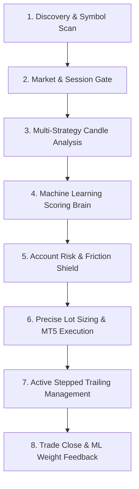

# QuantClaw v4 — Architecture & Operations Manual

---

## 1. Executive Summary & Philosophy

**QuantClaw** is a fully autonomous institutional-grade algorithmic trading system and live telemetry platform engineered for MetaTrader 5 (MT5). It bridges Python quantitative computing, machine learning, and multi-session institutional technical analysis directly to retail and prop-firm brokerage accounts.

### Core Philosophy
1. **Capital Preservation First**: Never let a bad trade or illiquid market destroy an account. If market conditions deteriorate or commissions exceed expected profit, trades are blocked before hitting the order book.
2. **Asymmetrical Risk-to-Reward**: Stop losses are kept tight and structured around institutional order blocks or volatility bands. Winners are protected using a stepped trailing mechanism to let profits expand while systematically eliminating downside risk.
3. **Adaptive Self-Learning**: Strategy weights and signal acceptance thresholds are dynamically adjusted based on real-time trade outcomes recorded in an embedded SQLite journal.

---

## 2. High-Level System Architecture

```
┌────────────────────────────────────────────────────────────────────────┐
│                              QUANTCLAW                                 │
│                                                                        │
│   ┌────────────────────┐                 ┌─────────────────────────┐   │
│   │   MetaTrader 5     │◄───────────────►│      MT5 Engine         │   │
│   │ Terminal & Broker  │                 │  (Orders, Lots, Fills)  │   │
│   └────────────────────┘                 └────────────┬────────────┘   │
│                                                       │                │
│                                                       ▼                │
│   ┌────────────────────┐                 ┌─────────────────────────┐   │
│   │   Market Engine    │────────────────►│     Strategy Engine     │   │
│   │ (Candles, M15/H1)  │                 │ (Titan Pro, SMC, etc.)  │   │
│   └─────────┬──────────┘                 └────────────┬────────────┘   │
│             │                                         │ Signal         │
│             ▼                                         ▼                │
│   ┌────────────────────┐                 ┌─────────────────────────┐   │
│   │  Market Calendar   │                 │        ML Engine        │   │
│   │ (Session Scoring)  │                 │ (Bayesian Win Scoring)  │   │
│   └────────────────────┘                 └────────────┬────────────┘   │
│                                                       │ Approved       │
│                                                       ▼                │
│   ┌────────────────────┐                 ┌─────────────────────────┐   │
│   │     FastAPI +      │◄───────────────►│      Risk Manager       │   │
│   │ WebSockets + WebUI │                 │ (Shield, Soft SL, Trail)│   │
│   └────────────────────┘                 └────────────┬────────────┘   │
│                                                       │ Execution      │
│                                                       ▼                │
│   ┌────────────────────┐                 ┌─────────────────────────┐   │
│   │  Android Companion │                 │      Trade Journal      │   │
│   │   App (Live HUD)   │                 │   (SQLite Performance)  │   │
│   └────────────────────┘                 └─────────────────────────┘   │
└────────────────────────────────────────────────────────────────────────┘
```

---

## 3. The End-to-End Trade Lifecycle

Every potential trade passes through an 8-stage pipeline before any money is placed at risk:



### Stage 1: Dynamic Symbol Discovery
- At application startup and whenever an account switch is detected, `MT5Engine.auto_discover_symbols()` queries the active broker terminal.
- Finds all available forex majors, crosses, indices, and metals (e.g. `EURUSD.`, `XAUUSD.`, `NDXUSD.`).
- Cross-references user toggles in **Symbol Permissions** (`data/config.json`). If a symbol is unticked, it is immediately skipped.

### Stage 2: Session & Liquidity Filter
- `MarketCalendar` evaluates current UTC time against global trading sessions (Sydney, Tokyo, London, New York).
- Validates whether the instrument's market is actively trading (e.g., US index futures over the weekend or after-hours are blocked).
- Assigns a session score (0.0 to 100.0). If `enable_session_filter` is turned on and session score falls below `session_min_score`, no scans are run.

### Stage 3: Strategy Engine Evaluation
- The symbol's M15, H1, and H4 candles are evaluated by enabled strategy algorithms:
  - **Titan Pro**: Trend-following pullback off key moving averages and Supertrend.
  - **SMC Liquidity**: Fair Value Gaps (FVG), Order Blocks, and Liquidity Sweeps.
  - **OCC R5**: SMMA momentum crossovers.
  - **Quant Way**: Volume-weighted EMA momentum.
- An initial signal is formed containing `entry_price`, `stop_loss`, `take_profit`, and initial `confidence`.

### Stage 4: Machine Learning Conviction Gate
- `MLEngine` scores the setup across multiple technical factors:
  - Higher Timeframe (H1/H4) trend alignment.
  - Volatility & ADX strength (filters out dead or choppy sideways consolidation).
  - Historical win-rate circuit breaker for the specific strategy:
    - Strategies with $\ge 4$ trades and $< 35\%$ win rate receive an automatic **$-15.0$ penalty**.
    - Strategies with $\ge 4$ trades and $\ge 60\%$ win rate receive an automatic **$+8.0$ bonus**.
- If the final ML score $\ge$ `ml_brain_min_execute_score` (default: 70.0), the signal is **APPROVED**.

### Stage 5: Account Risk & Commission Shield
- `RiskManager.evaluate_pre_trade_risk()` tests the trade against four strict safety constraints:
  1. **Daily Drawdown Limit**: Today's loss cannot exceed `daily_max_loss_pct` of starting equity.
  2. **Consecutive Loss Cooldown**: If consecutive losses exceed `max_consecutive_losses` (default: 3), trading is temporarily halted for `loss_cooldown_seconds`.
  3. **Spread Ceiling**: Current spread must be below `max_spread_points`.
  4. **Commission Friction Shield**: Estimates round-trip broker commission and compares it to projected dollar profit at Take-Profit. If commission exceeds `commission_max_pct_of_tp` (15%), the trade is **rejected** (protecting small accounts from predatory crypto/index fees).

### Stage 6: Lot Sizing & Order Placement
- Dynamic lot sizing calculates the exact position size based on:
  $$\text{Lots} = \frac{\text{Target Risk USD}}{\text{SL Distance in Points} \times \text{Tick Value per Lot}}$$
- Respects broker minimum lots (0.01), maximum lots, and lot steps.
- Uses `mt5_determine_filling_type_bitmask` to match the broker's supported order filling policy (`ORDER_FILLING_IOC`, `ORDER_FILLING_RETURN`, or `ORDER_FILLING_FOK`).

### Stage 7: Active Trade Management & Stepped Trailing
Once open, the active position is monitored every second:
- **Phase 1 (+0.75R)**: **Soft Risk Reduction**. Slashes initial risk by moving SL to `-0.25R` (cutting 75% of initial dollar risk while leaving breathing room).
- **Phase 2 (+1.20R)**: **Dynamic Breakeven**. Moves SL to `entry_price + offset` (100% risk-free trade).
- **Phase 3 (+1.80R)**: **Stage 1 Profit Lock & Partial TP**. Closes 40% of the position volume to bank guaranteed profit, and moves SL to `+0.80R`.
- **Phase 4 (+2.80R)**: Full target execution or dynamic ATR trailing for extended runners.

### Stage 8: Journaling & Adaptive Learning
- When the trade closes (via TP, SL, or manual intervention), the outcome is logged to `data/trade_journal.db`.
- `MLEngine` receives the result: winning setups reinforce the factor weights that triggered them, while losing setups reduce the weight of their active factors.

---

## 4. Strategy Engines Explained

### 1. Titan Pro (`strategy_titan_pro_enabled`)
* **Core Style**: Multi-timeframe trend pullback.
* **Mechanism**: 
  - Analyzes H1 trend direction using an EMA corridor (Fast EMA 21 / Slow EMA 55) and ATR volatility bands.
  - On M15, waits for price to pull back to the value zone (between EMA 21 and EMA 50) in the direction of the H1 macro trend.
  - Enters on an engulfing candle or price rejection wick.
  - Sets SL beyond the recent swing high/low with a default target of 1:2.0 to 1:2.8 R:R.

### 2. SMC Liquidity / Smart Money Concepts (`strategy_smc_enabled`)
* **Core Style**: Institutional liquidity sweeps and Fair Value Gaps.
* **Mechanism**:
  - Identifies Asian/London session highs and lows.
  - Detects **Liquidity Sweeps**: price spikes above swing highs or below swing lows to trigger retail stop losses, followed by an immediate reversal.
  - Confirms Market Structure Shift (MSS/CHoCH) on candle close.
  - Locates **Fair Value Gaps (FVG)** and enters on the mitigation retest.
  - Targets external liquidity pools on the opposing side.

### 3. OCC R5 (`strategy_occ_r5_enabled`)
* **Core Style**: Smoothed Moving Average momentum cross.
* **Mechanism**:
  - Employs Open-Close Cross logic driven by Hull Moving Averages / SMMA.
  - Requires ADX trend confirmation ($ADX > 16.0$) to avoid whipsaws during choppy range-bound markets.

### 4. Quant Way (`strategy_quant_way_enabled`)
* **Core Style**: Volume-weighted exponential breakout.
* **Mechanism**:
  - Tracks volume spikes ($1.5\times$ average 20-period volume) aligned with EMA 13 / EMA 34 momentum alignment.
  - Excellent for fast-moving indices (NDX, US30) and Gold during London/New York market open.

---

## 5. Risk Management & Capital Defense Architecture

| Feature | Setting Key | Default | Function |
| :--- | :--- | :--- | :--- |
| **Max Dollar Risk per Trade** | `max_risk_usd_per_trade` | `$6.00` | Hard cap on dollar loss for any single trade. |
| **Min Dollar Risk per Trade** | `min_risk_usd_per_trade` | `$2.00` | Minimum allocation floor to ensure trade viability. |
| **Target Risk USD Override** | `target_risk_usd_override` | `$6.00` | Fixed dollar amount risked per setup. |
| **Max Spread Points** | `max_spread_points` | `35` | Rejects trades if broker spread exceeds threshold. |
| **Commission Friction Shield** | `commission_max_pct_of_tp` | `15.0%` | Blocks trades where broker commissions eat $>15\%$ of TP. |
| **Soft Risk Reduction** | `enable_soft_risk_reduction` | `True` | Slashes 75% of initial SL risk once trade reaches +0.75R. |
| **Breakeven Trigger** | `enable_breakeven_trigger` | `True` | Locks trade to 0 loss at +1.20R. |
| **Partial TP Stage 1** | `enable_partial_tp_ladder` | `True` | Closes 40% volume at +1.80R and locks SL at +0.80R. |
| **Daily Loss Kill-Switch** | `daily_max_loss_pct` | `5.0%` | Halts all trading if account suffers 5% drawdown in a day. |
| **Consecutive Loss Cooldown** | `max_consecutive_losses` | `3` | Pauses scanning for 30 minutes after 3 consecutive losses. |

---

## 6. Machine Learning Scoring Matrix

When a trade signal is generated, `MLEngine` scores it from 0 to 100 based on weighted factors:

```
Total Conviction Score = Base Score (50.0)
                       + (HTF Trend Alignment * Weight)
                       + (ADX Trend Strength * Weight)
                       + (Volume Expansion * Weight)
                       + (SMC Structure Confluence * Weight)
                       + (Session Optimal Timing * Weight)
                       + Strategy Win-Rate Adjustment (-15.0 to +8.0)
```

- **Approval Threshold**: $\ge 70.0$.
- Any setup scoring below 70.0 is logged as an unexecuted shadow trade to track whether it would have won or lost, feeding the self-learning memory without risking real balance.

---

## 7. Configuration Files & Precedence

QuantClaw uses a two-tier configuration persistence model:

1. **System AppData Config** (Active Runtime):
   `%APPDATA%\QuantClaw\config.json`
   Loaded first. Contains user settings modified via the Web Dashboard or Desktop GUI.
2. **Local Project Config** (Fallback & Repository Template):
   `LASTHOPE\data\config.json` and `LASTHOPE\data\config.example.json`
   Used as fallback if AppData is not yet created.

> [!IMPORTANT]
> When saving settings from the Web Dashboard or API, QuantClaw automatically writes to both `%APPDATA%\QuantClaw\config.json` and `data/config.json` to keep both environments synchronized.

---

## 8. Web Telemetry Dashboard & REST API

The embedded server runs on `http://127.0.0.1:8000`:

* **Web UI Dashboard**: Glassmorphic, dark-mode real-time interface displaying live PnL, open positions, active circuit breakers, and symbol permissions.
* **REST API Endpoints**:
  - `GET /api/v4/state`: Complete bot status, armed status, equity, daily PnL.
  - `POST /api/v4/arm`: Arm the bot for autonomous execution.
  - `POST /api/v4/disarm`: Disarm trading instantly.
  - `GET /api/v4/symbols`: Fetch all broker symbols, active status, and priority order.
  - `POST /api/v4/symbols/toggle`: Enable or disable specific trading pairs.
  - `GET /api/v4/settings`: Query active configuration parameters.
  - `POST /api/v4/settings`: Update settings with instant validation.
  - `GET /api/v4/trades`: Historical closed trades from SQLite journal.
* **WebSocket**:
  - `ws://127.0.0.1:8000/ws`: Pushes live tick updates, position modifications, and ML logs to connected browsers and the Android app.

---

## 9. Operating Instructions: How to Run the Bot

### Prerequisites
1. MetaTrader 5 Desktop Terminal installed and signed in to your broker account (Tradiso, Elefin, FTMO, etc.).
2. In MT5, ensure **Algo Trading** button is enabled in the top toolbar.
3. In MT5 **Tools -> Options -> Expert Advisors**:
   - Check `Allow Algo Trading`.
   - Check `Allow DLL imports`.

### Starting the Bot
Run the provided launcher batch file:
```cmd
Start_QuantClaw.bat
```
Or start via Python:
```powershell
python -m quantclaw.main
```

### Dashboard Access
Open your web browser and navigate to:
```
http://localhost:8000
```
- Verify the **Armed** badge is green (or click **ARM**).
- Verify the **Symbol Permissions** card shows your desired pairs ticked (e.g. `XAUUSD.`, `EURUSD.`, `GBPUSD.`).
- The bot will automatically begin scanning market intervals and execute qualified setups.
